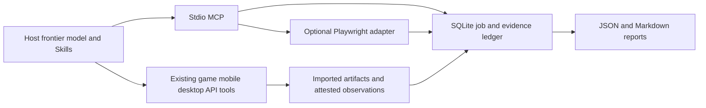

# Architecture and trust boundaries

The client owns model inference and tool authorization. This server owns a local evidence ledger. Skills describe how to use both. There is no nested paid-model loop and no hidden cloud service.

## Persistent state

Contracts are immutable per job. Builds changed by fixes require a new job. SQLite immediate transactions serialize action-budget reservations across local clients. Events describe started and finished actions; an interrupted action must be reconciled before finalization. Checkpoints store explored areas, hypotheses and next actions. Wall-clock budget starts at creation and includes pause time.

Budget exhaustion stops new harness actions and new runs. Evidence capture, checkpointing, recording already-observed findings/reproduction results, cleanup and finalization remain possible. The host's unrelated tools are not intercepted. Model token/cost usage is not observable from a generic MCP server; cost is explicitly reported only.

## Evidence

Workspace artifact imports are resolved and checked to stay inside the configured workspace, then copied under generated IDs. Reports verify the stored SHA-256. Artifacts bind to jobs and runs. A reproduction must have a separate reproduction run and fresh run-local artifact references. This prevents accidental mixing; it does not prove imported content is truthful. A malicious same-user process can modify both the database and files. This is not an external audit-signing service.

`confirmed` means the operator recorded successful reproduction with evidence. It does not imply an independent human examiner, statistical certainty or guaranteed fixture reset. Results contain source labels (`browser_collected`, `operator_imported`, `operator_attested`). Inspect artifacts before drawing conclusions.

## Browser

The browser is ephemeral. Each start creates an isolated Chromium context; cookies/storage do not persist between starts. Server/database reset is external. Only listed HTTP(S) origins are allowed by request routing; WebSockets are blocked, service workers are blocked, popups are closed and downloads are not accepted. No arbitrary JS evaluator or shell execution tool is exposed.

Request routing is not a security sandbox or full browser-process network firewall. Hostile/untrusted content needs OS/network isolation. The optional driver currently does not support cross-origin popups, WebSocket applications, mobile emulation, video, tracing, file upload or full accessibility-tree observation. Use the host's existing tools when those capabilities are necessary and label external evidence.

Before/after screenshots and bounded console/error/visible-text observations are captured for actions. Errors are recorded as unknown rather than automatically retried. Values passed to fill are redacted from action metadata only; screen and target logs can still reveal them.

## Software and games

Use existing test runners and engine/computer-use tools; import outputs. Source/static analysis can support hypotheses but does not establish executed behavior. Engine APIs and native player input establish different acceptance claims. A game driver and GPU/device farm are extension points, not shipped implementations.

## Service deployment

This release is stdio and local. It does not implement network authentication, tenant authorization, hosted workers, leasing, billing integration, retention automation or a customer portal. Separate data roots/processes are organizational separation; operating-system boundaries are needed between untrusted tenants. No files or reports are published automatically.

Target text, artifacts and source code are untrusted task data. They must not change the host's instructions or widen the authorized target. The Skills preserve that distinction, while the host's own permission system remains responsible for other tools.
